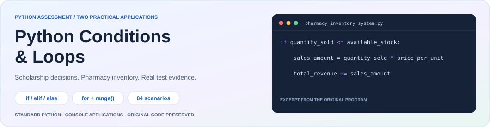
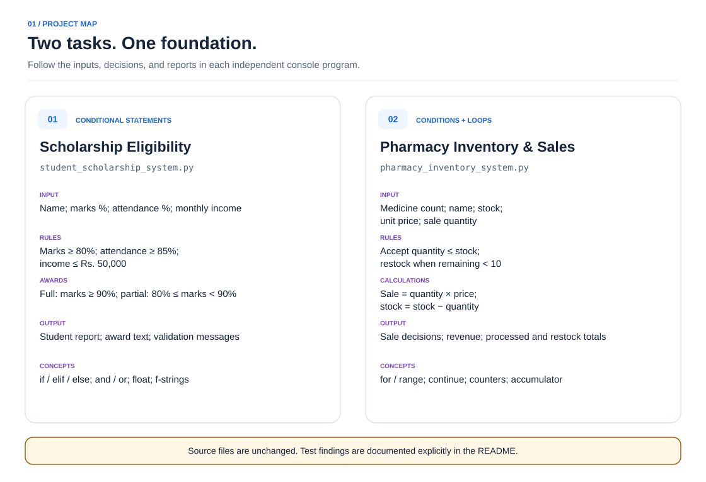
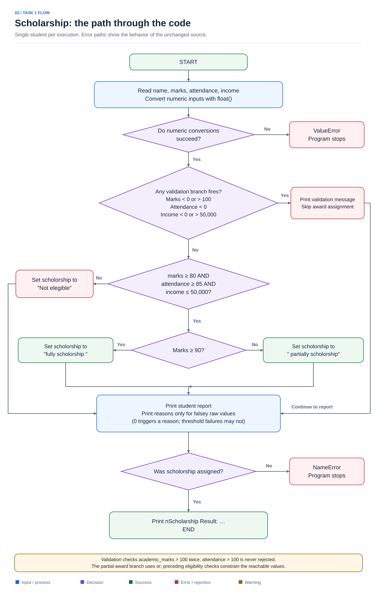
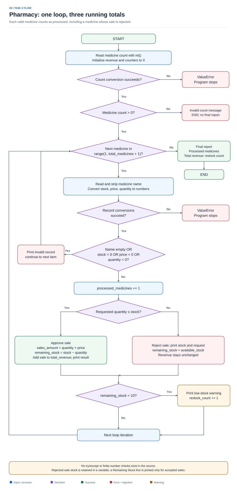
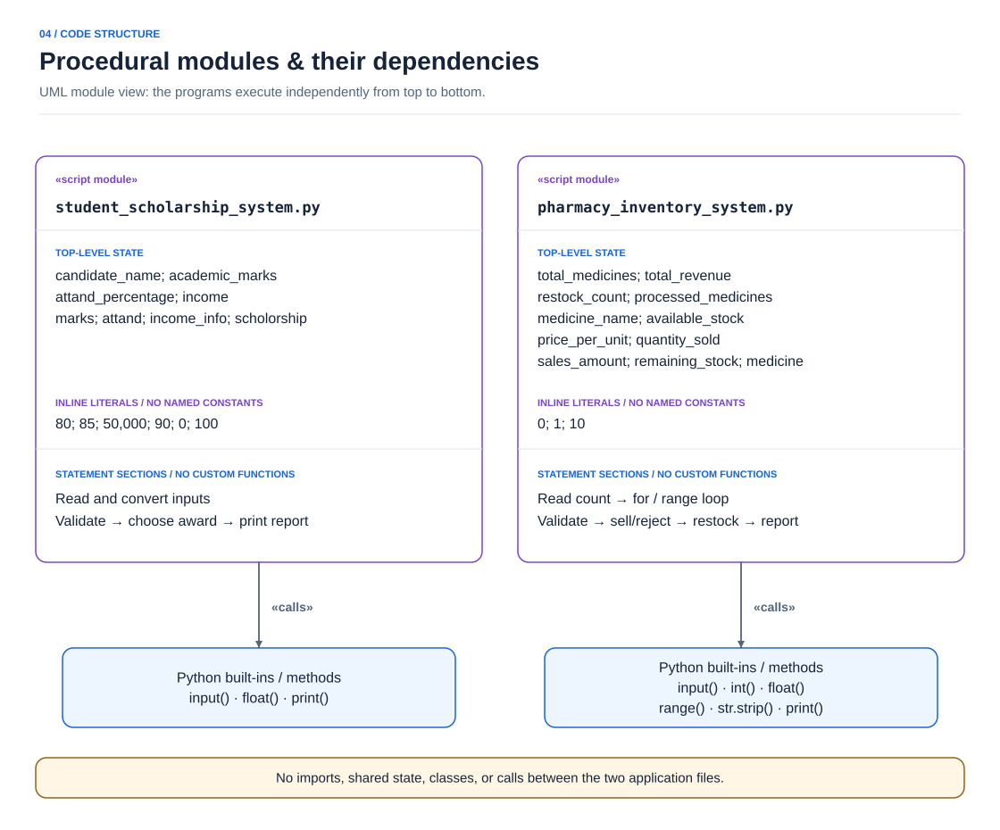

<p align="center"></p>

# Python Conditions & Loops Assessment

Two standalone console programs for scholarship eligibility and pharmacy sales, with diagrams and evidence from real executions.

**2 programs** · **84 executed scenarios** · **5 original SVGs** · **Standard Python**

## 1. Project Overview

| Task | File | Main topic | Result |
| --- | --- | --- | --- |
| 1 · Student Scholarship Eligibility System | [`student_scholarship_system.py`](student_scholarship_system.py) | Conditional statements | Student evaluation report and scholarship decision |
| 2 · Smart Pharmacy Inventory & Sales Management System | [`pharmacy_inventory_system.py`](pharmacy_inventory_system.py) | Conditions, loops, counters, accumulator | Sale results, revenue, processed count and restock count |



> **Source preservation:** Both Python files are byte-for-byte copies of the supplied uploads. Their uploaded `(2)` filename suffixes were removed to match the supplied repository structure; their contents, spelling, formatting and behavior are unchanged.
>
> **Verification:** Both files compile under Python 3.12.14. Of 84 executed scenarios, **40 meet the documented expectations and 44 record findings**. All 84 observation checks matched the captured behavior. This is evidence of the current source, not a claim that every requirement passes.

**Assumptions:** The pasted brief contains a placeholder, so the task instructions embedded in the programs and the supplied README define the scope. The repository name follows that README. Author and GitHub username remain `YOUR NAME` and `YOUR_USERNAME`. No marking weights were supplied.

<details>
<summary><strong>Requirement inventory and assessment focus</strong></summary>

| Area | Required scope |
| --- | --- |
| Task 1 inputs | Student name, academic marks, attendance percentage and monthly family income |
| Task 1 validation | Validate the supplied information before making a decision |
| Task 1 eligibility | Marks ≥ 80%; attendance ≥ 85%; income ≤ Rs. 50,000; all three must pass |
| Task 1 awards | Full scholarship at ≥ 90%; partial scholarship from 80% to below 90% |
| Task 1 report | Full evaluation report and appropriate reasons for ineligibility |
| Task 2 loop | Ask the medicine count and process entries using a `for` loop |
| Task 2 inputs | Name, available stock, unit price and requested sale quantity |
| Task 2 decisions | Accept quantities within stock; reject requests exceeding stock |
| Task 2 calculations | Calculate each approved sale and remaining stock; accumulate daily revenue |
| Task 2 counters | Count valid processed entries and medicines with remaining stock below 10 |
| Task 2 report | Total medicines processed, pharmacy revenue and medicines needing restocking |
| Required repository | `python-conditions-loops-assessment/` containing the two named `.py` files and `README.md` |
| Added documentation | `assets/` contains five self-contained SVGs and their PNG renderings |
| Submission | Public GitHub repository URL plus the three required source/documentation files through the LMS, as stated in the supplied README |
| Assessment focus | Conditions, comparisons, logical operators, loops, validation, counters, accumulators and clear console output; no numerical rubric was provided |

Preserving the supplied source takes priority over refactoring or fixing it. Findings are recorded in the task notes and test tables.

</details>

## 2. Folder Structure

```text
python-conditions-loops-assessment/
├── student_scholarship_system.py
├── pharmacy_inventory_system.py
├── README.md
└── assets/
    ├── banner.svg
    ├── banner.png
    ├── overview.svg
    ├── overview.png
    ├── student_scholarship_system_flow.svg
    ├── student_scholarship_system_flow.png
    ├── pharmacy_inventory_system_flow.svg
    ├── pharmacy_inventory_system_flow.png
    ├── uml_diagram.svg
    └── uml_diagram.png
```

`assets/` is the only added repository folder. The README uses SVGs; PNG copies are included for viewing or reuse. The complete download also supplies HTML previews, the input-driven test runner, test logs and submission notes **outside** this repository folder.

## 3. Task 1 — Student Scholarship Eligibility System

### Summary

[`student_scholarship_system.py`](student_scholarship_system.py) evaluates one student per run. Its top-level statements collect data, evaluate conditions and print a report. It defines no custom functions or classes and contains no loop.

### Rules or Requirements

- Collect the student's name, marks, attendance and monthly family income.
- Validate marks and attendance as percentages; reject invalid information.
- Require marks ≥ 80%, attendance ≥ 85% and income ≤ Rs. 50,000 together.
- Award a full scholarship at marks ≥ 90%, or a partial scholarship below 90% when all eligibility requirements pass.
- Explain failed eligibility rules and display the evaluation report.

### Program Flow



Blue indicates input or processing, purple decisions, green successful paths, red rejection or errors, and amber implementation notes. The diagram follows the current code, including its failure paths.

### Code Methods Description

These are existing statement sections and built-in calls, rather than user-defined methods.

| Method or section | Purpose |
| --- | --- |
| `input()`; `candidate_name` | Read the student's name |
| `float(input(...))` | Read and convert `academic_marks`, `attand_percentage` and `income` |
| Initial `if` / `elif` chain | Check marks, negative attendance and income range |
| `marks`, `attand`, `income_info` | Store the three eligibility comparisons as Boolean values |
| `if marks and attand and income_info` | Require all eligibility checks to pass |
| Nested award conditions; `scholorship` | Choose the existing full, partial or ineligible result text |
| Final `print()` calls | Display the student values, truthiness-based reasons and final result |

### Input Validation

| Input | Current implementation | Finding |
| --- | --- | --- |
| Name | Stored directly from `input()` | Empty and whitespace-only names are accepted |
| Marks | Checks values below 0 or above 100 | Invalid-range branches leave `scholorship` unassigned; the final print raises `NameError` |
| Attendance | Checks values below 0 | The upper-bound check repeats `academic_marks > 100`; attendance above 100 is accepted |
| Income | Checks values below 0 or above 50,000 | Above-limit income prints a validation message, then raises `NameError`, instead of completing a rejection report |
| Numeric conversion | Uses `float()` directly | Non-numeric or empty numeric input raises uncaught `ValueError` |
| Non-finite values | No finite-number check | Some `nan` / `inf` inputs reach the award or report logic |

The rejection-reason checks use the raw numeric values, such as `if not academic_marks`, instead of checking failed thresholds. Consequently, a positive failing value such as 79.99 gets no marks reason, while zero income incorrectly produces an excessive-income reason. The final label is printed as `nScholarship Result:` and the original award spelling is retained below.

### Expected Results

| Valid input condition | Intended decision | Observed result text |
| --- | --- | --- |
| All rules pass; marks ≥ 90 | Full Scholarship | `fully scholorship ` |
| All rules pass; 80 ≤ marks < 90 | Partial Scholarship | ` partially scholorship` |
| Marks or attendance below its threshold | Not Eligible with reasons | `Not elegible`; reasons may be missing |
| Income above Rs. 50,000 | Not Eligible with income reason | `incorrect income info`, followed by `NameError` |

Decisions use the original numeric values. For example, 89.9999 prints as `90.00%` but still receives a partial award.

## 4. Task 2 — Smart Pharmacy Inventory & Sales Management System

### Summary

[`pharmacy_inventory_system.py`](pharmacy_inventory_system.py) processes a requested number of medicine entries in a `for` loop. It accepts or rejects each sale, calculates revenue, checks remaining stock and prints aggregate totals.

### Rules or Requirements

- Ask for a positive medicine count and loop through that many entries.
- Read the medicine name, available stock, unit price and sale quantity.
- Accept a sale when requested quantity ≤ available stock; otherwise reject it.
- Calculate sale amount as quantity × unit price and accepted-sale remaining stock as stock − quantity.
- Accumulate revenue only for accepted sales.
- Warn and count restocking when remaining stock is strictly below 10.
- Report valid entries processed, revenue and the restocking count.

### Program Flow



A rejected sale retains the entered stock. It still counts as a processed medicine and can trigger a restocking warning. An invalid record is skipped before the processed counter increases.

### Code Methods Description

| Method or section | Purpose |
| --- | --- |
| `int(input(...))`; `total_medicines` | Read the requested loop count |
| `total_revenue`, `restock_count`, `processed_medicines` | Initialize the accumulator and counters to zero |
| `for medicine in range(1, total_medicines + 1)` | Process each numbered medicine entry |
| `input().strip()`; numeric conversions | Read the trimmed name, stock, price and quantity |
| Validation condition; `continue` | Skip blank names and negative numeric values |
| `processed_medicines += 1` | Count a valid entry before evaluating its sale |
| `quantity_sold <= available_stock` | Choose the accepted-sale or rejected-sale branch |
| `sales_amount`; `remaining_stock` | Calculate an approved sale and its remaining stock, or retain stock after rejection |
| `total_revenue += sales_amount` | Accumulate accepted-sale revenue |
| `remaining_stock < 10`; `restock_count += 1` | Print a warning and count a low-stock entry |
| Final `print()` calls | Display processed count, revenue and restocking count |

### Input Validation

| Input | Current implementation | Limitation |
| --- | --- | --- |
| Medicine count | Converts with `int()`; rejects zero or negative values | Text or fractional input raises uncaught `ValueError` |
| Medicine name | Uses `.strip()`; blank values are skipped | All numeric inputs are read before semantic validation |
| Stock and quantity | Convert with `int()`; negative values are skipped | Malformed or fractional input stops the program |
| Unit price | Converts with `float()`; negative values are skipped | `nan` / positive `inf` are accepted; a very large finite price can overflow during multiplication |

Zero stock, zero sale quantity and a zero price are accepted. A medicine with zero stock and zero requested quantity prints a successful zero-value sale and a restock warning. Invalid numeric conversions stop execution before a final report.

### Expected Results

| Scenario | Observed behavior |
| --- | --- |
| Stock 50; price Rs. 150; quantity 10 | Accepted; Rs. 1500.00; 40 left |
| Stock 10; price Rs. 20; quantity 3 | Accepted; Rs. 60.00; 7 left; one restock warning |
| Stock 8; quantity 12 | Rejected; no revenue added; 8 retained; one restock warning |
| Exactly 10 units remain | No low-stock warning |
| Requested quantity equals stock | Accepted; zero remains; restocking required |
| Invalid record followed by a valid record | First skipped; second processed normally |

The rejected-sale branch prints available stock and requested quantity. It does **not** print a `Remaining Stock:` line. Entries are independent; repeated names do not share stored inventory. Neither program saves data between runs.

## 5. UML Diagram

A **UML module diagram** fits this project because both files are procedural scripts with top-level state and built-in calls, and neither defines classes or custom functions.



The diagram lists actual variable names, inline literal thresholds, statement sections and `«calls»` dependencies. The source contains no named constants and no imports or inter-module calls.

## 6. Concepts and Techniques Used

- `input()` and `print()` for terminal interaction.
- `int()` and `float()` for numeric conversion.
- `if`, `elif` and `else` for validation and decisions.
- Comparison operators and `and`, `or`, `not` for conditions.
- `for` with `range()` for repeated medicine processing.
- `continue` to skip an invalid medicine entry.
- Counters and an accumulator with `+=`.
- Multiplication, subtraction, f-strings and `:.2f` formatting.
- `.strip()` for pharmacy-name validation.

The supplied files do not implement `try` / `except`, `math.isfinite()`, reusable custom functions or named constants. Those features are not claimed as completed work.

## 7. How to Run

**Requirements:** Python 3 and a terminal. The supplied README specifies Python 3.8 or later; the actual verification used **Python 3.12.14**. The application files require no third-party packages.

### Clone or Download

```bash
git clone https://github.com/YOUR_USERNAME/python-conditions-loops-assessment.git
cd python-conditions-loops-assessment
```

Replace `YOUR_USERNAME` with your GitHub username. Alternatively, extract the supplied ZIP and open a terminal inside `python-conditions-loops-assessment/`.

### Run Each Program Separately

```bash
python --version
python student_scholarship_system.py
python pharmacy_inventory_system.py
```

On systems using `python3`:

```bash
python3 student_scholarship_system.py
python3 pharmacy_inventory_system.py
```

With the Windows Python launcher:

```powershell
py student_scholarship_system.py
py pharmacy_inventory_system.py
```

Follow each program's prompts. Enter plain numeric values, such as `50000`, without currency symbols or thousands separators.

## 8. Sample Execution

These terminal transcripts were captured from real runs of the unchanged files on 17 November 2026. Inputs are echoed by the terminal. Original prompts, spelling and result labels are preserved.

### Task 1 · Scholarship

<details>
<summary><strong>S02 · Full scholarship at the exact eligibility boundaries</strong></summary>

Marks 90, attendance 85 and income 50000 produce the existing full-award label.

```text
===============Evaluation for scholorship===============
Enter the student name Test Student
enter student marks in percentage90
enter your attandance percentage85
enter family income50000

========== SCHOLARSHIP REPORT ==========
Student Name: Test Student
Academic Marks: 90.00%
Attendance: 85.00%
Monthly Family Income: Rs. 50000.00
Eligibility Evaluation:
nScholarship Result: fully scholorship 
```

</details>
<details>
<summary><strong>S04 · Partial scholarship at the minimum qualifying values</strong></summary>

Marks 80, attendance 85 and income 50000 produce the existing partial-award label.

```text
===============Evaluation for scholorship===============
Enter the student name Test Student
enter student marks in percentage80
enter your attandance percentage85
enter family income50000

========== SCHOLARSHIP REPORT ==========
Student Name: Test Student
Academic Marks: 80.00%
Attendance: 85.00%
Monthly Family Income: Rs. 50000.00
Eligibility Evaluation:
nScholarship Result:  partially scholorship
```

</details>
<details>
<summary><strong>S06 · Low marks: rejection with a missing reason</strong></summary>

Only marks fail. The program rejects the student, but the evaluation contains no explanation.

```text
===============Evaluation for scholorship===============
Enter the student name Test Student
enter student marks in percentage79.99
enter your attandance percentage90
enter family income30000

========== SCHOLARSHIP REPORT ==========
Student Name: Test Student
Academic Marks: 79.99%
Attendance: 90.00%
Monthly Family Income: Rs. 30000.00
Eligibility Evaluation:
nScholarship Result: Not elegible
```

</details>
**S08 · Income failure:** Inputs `Test Student / 95 / 90 / 50000.01` print `incorrect income info`. The final line of the captured error stream is:

```text
NameError: name 'scholorship' is not defined
```

### Task 2 · Pharmacy

<details>
<summary><strong>P02 · Five medicines and a combined revenue of Rs. 5435.00</strong></summary>

The accepted sales total 1500 + 1500 + 1800 + 60 + 575. Only baydall finishes below 10 units.

```text
========== SMART PHARMACY SYSTEM ==========
How many medicines do you want to process? 5
========== MEDICINE 1 ==========
Enter medicine name: penadol
Enter available stock: 50
Enter price per unit (Rs.): 150
Enter quantity sold: 10

Sale Successful!
Medicine: penadol
Sales Amount: Rs. 1500.00
Remaining Stock: 40
========== MEDICINE 2 ==========
Enter medicine name: Mogral
Enter available stock: 50
Enter price per unit (Rs.): 300
Enter quantity sold: 5

Sale Successful!
Medicine: Mogral
Sales Amount: Rs. 1500.00
Remaining Stock: 45
========== MEDICINE 3 ==========
Enter medicine name: dawtor
Enter available stock: 56
Enter price per unit (Rs.): 200
Enter quantity sold: 9

Sale Successful!
Medicine: dawtor
Sales Amount: Rs. 1800.00
Remaining Stock: 47
========== MEDICINE 4 ==========
Enter medicine name: baydall
Enter available stock: 10
Enter price per unit (Rs.): 20
Enter quantity sold: 3

Sale Successful!
Medicine: baydall
Sales Amount: Rs. 60.00
Remaining Stock: 7
WARNING: baydall requires restocking!
========== MEDICINE 5 ==========
Enter medicine name: extore
Enter available stock: 45
Enter price per unit (Rs.): 23
Enter quantity sold: 25

Sale Successful!
Medicine: extore
Sales Amount: Rs. 575.00
Remaining Stock: 20

========== FINAL PHARMACY REPORT ==========
Total Medicines Processed: 5
Total Pharmacy Revenue: Rs. 5435.00
Medicines Requiring Restocking: 1
=================================================
```

</details>
<details>
<summary><strong>P06 · Rejected sale with a low-stock warning</strong></summary>

The requested quantity exceeds stock. The valid medicine still counts as processed; revenue stays zero.

```text
========== SMART PHARMACY SYSTEM ==========
How many medicines do you want to process? 1
========== MEDICINE 1 ==========
Enter medicine name: Augmentin
Enter available stock: 8
Enter price per unit (Rs.): 200
Enter quantity sold: 12

Sale Rejected!
Reason: Insufficient stock.
Available Stock: 8
Requested Quantity: 12
WARNING: Augmentin requires restocking!

========== FINAL PHARMACY REPORT ==========
Total Medicines Processed: 1
Total Pharmacy Revenue: Rs. 0.00
Medicines Requiring Restocking: 1
=================================================
```

</details>
<details>
<summary><strong>P23 · Invalid record skipped; next record processed</strong></summary>

A blank name is skipped with `continue`. The next medicine contributes Rs. 20.00 to revenue.

```text
========== SMART PHARMACY SYSTEM ==========
How many medicines do you want to process? 2
========== MEDICINE 1 ==========
Enter medicine name: 
Enter available stock: 20
Enter price per unit (Rs.): 5
Enter quantity sold: 2
Invalid medicine information. Skipping this medicine.
========== MEDICINE 2 ==========
Enter medicine name: M2
Enter available stock: 20
Enter price per unit (Rs.): 10
Enter quantity sold: 2

Sale Successful!
Medicine: M2
Sales Amount: Rs. 20.00
Remaining Stock: 18

========== FINAL PHARMACY REPORT ==========
Total Medicines Processed: 1
Total Pharmacy Revenue: Rs. 20.00
Medicines Requiring Restocking: 0
=================================================
```

</details>
**P14 · Invalid count:** Entering `abc` for the medicine count stops the program. The final line of the captured error stream is:

```text
ValueError: invalid literal for int() with base 10: 'abc'
```

## 9. Test Cases

**84 scenarios executed:** 40 scholarship cases and 44 pharmacy cases, including normal inputs, threshold boundaries, each rule failing alone, combined failures, malformed input and non-finite values.

| Task | Scenarios | Expected behavior met | Findings |
| --- | ---: | ---: | ---: |
| Scholarship | 40 | 11 | 29 |
| Pharmacy | 44 | 29 | 15 |
| **Total** | **84** | **40** | **44** |

**PASS** means the captured behavior meets the stated expectation. **FINDING** means the run exposes a requirement or validation gap. Several scenarios can expose the same underlying defect; these counts are not a grade or a count of unique bugs. The runner separately confirms all 84 recorded observations, including expected error exits.

### Task 1 · Scholarship Tests

Inputs are **marks / attendance / income**, with `Test Student` as the name unless another name is shown. `(empty)` and `(spaces × 3)` denote literal blank and whitespace inputs.

<details>
<summary><strong>View all 40 scholarship test cases</strong></summary>

| # | Scenario | Inputs | Expected result |
| --- | --- | --- | --- |
| S01 | Normal full award | 95 / 90 / 40000 | **PASS** — Full award. |
| S02 | Full-award boundary | 90 / 85 / 50000 | **PASS** — Full award at inclusive limits. |
| S03 | Decimal partial award | 89.5 / 85 / 50000 | **PASS** — Partial award. |
| S04 | Minimum eligibility limits | 80 / 85 / 50000 | **PASS** — Partial award. |
| S05 | Zero income is valid | 100 / 100 / 0 | **FINDING** — Expected: Full award without an income-failure reason. Observed: Full award, but falsely flags zero income. |
| S06 | Marks fail alone | 79.99 / 90 / 30000 | **FINDING** — Expected: Reject and explain low marks. Observed: Not elegible; low-marks reason omitted. |
| S07 | Attendance fails alone | 90 / 84.99 / 30000 | **FINDING** — Expected: Reject and explain low attendance. Observed: Not elegible; low-attendance reason omitted. |
| S08 | Income fails alone | 95 / 90 / 50000.01 | **FINDING** — Expected: Reject and explain excessive income. Observed: Income message, then NameError. |
| S09 | Marks and attendance fail | 70 / 70 / 40000 | **FINDING** — Expected: Reject and explain both failures. Observed: Not elegible; both reasons omitted. |
| S10 | All eligibility rules fail | 70 / 70 / 60000 | **FINDING** — Expected: Reject and explain all three failures. Observed: Income message, then NameError; all reasons are not reported. |
| S11 | Zero marks | 0 / 90 / 20000 | **PASS** — Reject with a low-marks reason. |
| S12 | Zero attendance | 90 / 0 / 20000 | **PASS** — Reject with a low-attendance reason. |
| S13 | All numeric inputs zero | 0 / 0 / 0 | **FINDING** — Expected: Reject for marks and attendance only. Observed: Rejects but falsely flags zero income. |
| S14 | Marks below zero | -0.01 / 90 / 30000 | **FINDING** — Expected: Validation message without crashing. Observed: Marks message, then NameError. |
| S15 | Marks above 100 | 100.01 / 90 / 30000 | **FINDING** — Expected: Validation message without crashing. Observed: Marks message, then NameError. |
| S16 | Attendance below zero | 90 / -0.01 / 30000 | **FINDING** — Expected: Validation message without crashing. Observed: Attendance message, then NameError. |
| S17 | Attendance above 100 | 90 / 100.01 / 30000 | **FINDING** — Expected: Reject out-of-range attendance. Observed: Accepts attendance over 100; full award. |
| S18 | Negative family income | 90 / 90 / -0.01 | **FINDING** — Expected: Validation message without crashing. Observed: Income message, then NameError. |
| S19 | Empty student name | name=(empty); 90 / 90 / 30000 | **FINDING** — Expected: Reject a blank name. Observed: Accepts an empty name; full award. |
| S20 | Whitespace-only name | name=(spaces × 3); 90 / 90 / 30000 | **FINDING** — Expected: Reject a whitespace-only name. Observed: Accepts spaces as a name; full award. |
| S21 | Non-numeric marks | abc | **FINDING** — Expected: Clear input-validation message. Observed: Uncaught ValueError; execution stops. |
| S22 | Non-numeric attendance | 90 / abc | **FINDING** — Expected: Clear input-validation message. Observed: Uncaught ValueError; execution stops. |
| S23 | Non-numeric income | 90 / 90 / abc | **FINDING** — Expected: Clear input-validation message. Observed: Uncaught ValueError; execution stops. |
| S24 | Empty marks | (empty) | **FINDING** — Expected: Clear input-validation message. Observed: Uncaught ValueError; execution stops. |
| S25 | Empty attendance | 90 / (empty) | **FINDING** — Expected: Clear input-validation message. Observed: Uncaught ValueError; execution stops. |
| S26 | Empty income | 90 / 90 / (empty) | **FINDING** — Expected: Clear input-validation message. Observed: Uncaught ValueError; execution stops. |
| S27 | NaN marks | nan / 90 / 30000 | **FINDING** — Expected: Reject non-finite marks. Observed: Accepts NaN input; Not elegible. |
| S28 | Infinite marks | inf / 90 / 30000 | **FINDING** — Expected: Reject non-finite marks without crashing. Observed: Marks message, then NameError. |
| S29 | NaN attendance | 90 / nan / 30000 | **FINDING** — Expected: Reject non-finite attendance. Observed: Accepts NaN input; Not elegible. |
| S30 | Infinite attendance | 90 / inf / 30000 | **FINDING** — Expected: Reject non-finite attendance. Observed: Accepts infinity; full award. |
| S31 | NaN income | 90 / 90 / nan | **FINDING** — Expected: Reject non-finite income. Observed: Accepts NaN input; Not elegible. |
| S32 | Infinite income | 90 / 90 / inf | **FINDING** — Expected: Reject non-finite income without crashing. Observed: Income message, then NameError. |
| S33 | Negative infinite attendance | 90 / -inf / 30000 | **FINDING** — Expected: Reject non-finite attendance without crashing. Observed: Attendance message, then NameError. |
| S34 | Rounding below marks threshold | 79.9999 / 90 / 30000 | **FINDING** — Expected: Reject using the unrounded marks and explain why. Observed: Prints 80.00%, rejects raw 79.9999, omits reason. |
| S35 | Rounding below full-award threshold | 89.9999 / 90 / 30000 | **PASS** — Partial award based on the unrounded value. |
| S36 | Unicode student name | name=علی; 92 / 90 / 30000 | **PASS** — Full award and preserve the name. |
| S37 | Upper percentage limits | 100 / 100 / 50000 | **PASS** — Full award. |
| S38 | Small positive family income | 90 / 85 / 0.01 | **PASS** — Full award. |
| S39 | Low marks plus zero attendance | 75 / 0 / 30000 | **FINDING** — Expected: Explain both failed criteria. Observed: Only the zero-attendance reason appears. |
| S40 | Leading and trailing spaces in numeric input |  90  /  85  /  50000  | **PASS** — Parse numeric whitespace; full award. |

</details>

### Task 2 · Pharmacy Tests

Inputs are **n=count; (name, stock, unit price, sale quantity)**. A shortened tuple means the program crashed before requesting the remaining fields. P02's five records are shown in its full sample transcript.

<details>
<summary><strong>View all 44 pharmacy test cases</strong></summary>

| # | Scenario | Inputs | Expected result |
| --- | --- | --- | --- |
| P01 | Normal accepted sale | n=1 ; (Panadol, 50, 150, 10) | **PASS** — Rs. 1500.00; 40 left; 1 processed; 0 restock. |
| P02 | Five-medicine revenue total | 5; five records in sample P02 | **PASS** — 5 processed; Rs. 5435.00; 1 restock. |
| P03 | Zero sale at the stock limit | n=1 ; (M1, 10, 20, 0) | **PASS** — Zero revenue; 10 left; no warning. |
| P04 | Remaining stock of nine | n=1 ; (M1, 10, 20, 1) | **PASS** — Rs. 20.00; 9 left; 1 restock. |
| P05 | Sell the entire stock | n=1 ; (M1, 10, 20, 10) | **PASS** — Rs. 200.00; 0 left; 1 restock. |
| P06 | Rejected sale with low stock | n=1 ; (Augmentin, 8, 200, 12) | **PASS** — Reject; retain 8 units; 0 revenue; 1 restock. |
| P07 | Rejected sale with sufficient reserve | n=1 ; (M1, 20, 2, 21) | **PASS** — Reject; 20 retained; no restock. |
| P08 | Zero stock and zero request | n=1 ; (M1, 0, 10, 0) | **PASS** — Accept zero sale; warn about zero stock. |
| P09 | Zero stock and positive request | n=1 ; (M1, 0, 10, 1) | **PASS** — Reject; 0 revenue; 1 restock. |
| P10 | Zero unit price | n=1 ; (M1, 12, 0, 2) | **PASS** — Accept zero-value sale; 10 left. |
| P11 | Decimal unit price | n=1 ; (M1, 20, 2.75, 2) | **PASS** — Rs. 5.50; 18 left. |
| P12 | Zero medicine count | n=0 | **PASS** — Display invalid-count message; no final report. |
| P13 | Negative medicine count | n=-1 | **PASS** — Display invalid-count message; no final report. |
| P14 | Non-numeric medicine count | n=abc | **FINDING** — Expected: Clear input-validation message. Observed: Uncaught ValueError; execution stops. |
| P15 | Fractional medicine count | n=2.5 | **FINDING** — Expected: Clear input-validation message. Observed: Uncaught ValueError; execution stops. |
| P16 | Empty medicine count | n=(empty) | **FINDING** — Expected: Clear input-validation message. Observed: Uncaught ValueError; execution stops. |
| P17 | Empty medicine name | n=1 ; ((empty), 20, 5, 2) | **PASS** — Skip invalid record; all totals zero. |
| P18 | Whitespace-only medicine name | n=1 ; ((spaces × 3), 20, 5, 2) | **PASS** — Strip name and skip; all totals zero. |
| P19 | Negative available stock | n=1 ; (M1, -1, 5, 2) | **PASS** — Skip record; all totals zero. |
| P20 | Negative unit price | n=1 ; (M1, 20, -0.01, 2) | **PASS** — Skip record; all totals zero. |
| P21 | Negative requested quantity | n=1 ; (M1, 20, 5, -1) | **PASS** — Skip record; all totals zero. |
| P22 | Several invalid fields together | n=1 ; ((empty), -2, -1, -2) | **PASS** — Skip record once; all totals zero. |
| P23 | Skip then continue to valid record | n=2 ; ((empty), 20, 5, 2) ; (M2, 20, 10, 2) | **PASS** — Process second record; Rs. 20.00; 0 restock. |
| P24 | Rejected then accepted sale | n=2 ; (M1, 8, 5, 9) ; (M2, 20, 10, 2) | **PASS** — Count both valid records; Rs. 20.00; 1 restock. |
| P25 | Existing low stock and no sale | n=1 ; (M1, 9, 5, 0) | **PASS** — Zero revenue; 9 left; 1 restock. |
| P26 | Remaining stock of eleven | n=1 ; (M1, 12, 5, 1) | **PASS** — Rs. 5.00; 11 left; no restock. |
| P27 | Remaining stock of exactly ten | n=1 ; (M1, 12, 5, 2) | **PASS** — Rs. 10.00; 10 left; no restock. |
| P28 | Large integer quantity | n=1 ; (M1, 1000000000, 1, 1000000000) | **PASS** — Rs. 1000000000.00; 0 left; 1 restock. |
| P29 | Fractional stock | n=1 ; (M1, 3.5) | **FINDING** — Expected: Reject or skip without crashing. Observed: Uncaught ValueError; execution stops. |
| P30 | Non-numeric stock | n=1 ; (M1, abc) | **FINDING** — Expected: Reject or skip without crashing. Observed: Uncaught ValueError; execution stops. |
| P31 | Non-numeric unit price | n=1 ; (M1, 20, abc) | **FINDING** — Expected: Reject or skip without crashing. Observed: Uncaught ValueError; execution stops. |
| P32 | Fractional sale quantity | n=1 ; (M1, 20, 5, 1.5) | **FINDING** — Expected: Reject or skip without crashing. Observed: Uncaught ValueError; execution stops. |
| P33 | Non-numeric sale quantity | n=1 ; (M1, 20, 5, abc) | **FINDING** — Expected: Reject or skip without crashing. Observed: Uncaught ValueError; execution stops. |
| P34 | NaN unit price | n=1 ; (M1, 20, nan, 1) | **FINDING** — Expected: Reject a non-finite unit price. Observed: Accepts price; total revenue becomes nan. |
| P35 | Infinite unit price | n=1 ; (M1, 20, inf, 1) | **FINDING** — Expected: Reject a non-finite unit price. Observed: Accepts price; total revenue becomes inf. |
| P36 | Negative infinite price | n=1 ; (M1, 20, -inf, 1) | **PASS** — Skip the invalid negative price. |
| P37 | Zero multiplied by infinite price | n=1 ; (M1, 20, inf, 0) | **FINDING** — Expected: Reject a non-finite unit price. Observed: Accepts price; 0 × inf makes revenue nan. |
| P38 | Revenue overflows float range | n=1 ; (M1, 2, 1e308, 2) | **FINDING** — Expected: Keep revenue finite or report a validation error. Observed: Multiplication overflows; total revenue becomes inf. |
| P39 | All records skipped | n=3 ; ((empty), 20, 5, 2) ; (M2, -1, 5, 2) ; (M3, 20, 5, -1) | **PASS** — 0 processed; 0 revenue; 0 restock. |
| P40 | Duplicate names are independent entries | n=2 ; (M1, 20, 5, 2) ; (M1, 20, 5, 2) | **PASS** — 2 valid records; Rs. 20.00; 0 restock. |
| P41 | Comma-formatted unit price | n=1 ; (M1, 20, 1,000) | **FINDING** — Expected: Clear input-validation message. Observed: Uncaught ValueError; execution stops. |
| P42 | Blank name plus malformed price | n=1 ; ((empty), 20, abc) | **FINDING** — Expected: Skip invalid entry without crashing. Observed: Uncaught ValueError; execution stops. |
| P43 | Malformed first record halts loop | n=2 ; (M1, abc, M2, 20) ; (10, 2) | **FINDING** — Expected: Reject malformed record and continue. Observed: Uncaught ValueError; execution stops. |
| P44 | Two low-stock records | n=2 ; (M1, 9, 5, 0) ; (M2, 8, 5, 9) | **PASS** — 2 processed; 0 revenue; 2 restock. |

</details>

### Verification Evidence

The complete download includes `verification/` alongside the repository: the standard-library `run_tests.py` runner, all test inputs, captured stdout/stderr, a CSV summary, terminal transcripts and source SHA-256 hashes. From the extracted download's outer directory, rerun it with:

```bash
python verification/run_tests.py
```

The runner checks source hashes, compiles both programs in memory and executes every input scenario. A successful runner result verifies the documented observations; inspect **FINDING** rows for unresolved application issues. The two source files remain unchanged.

---

**Author:** Muhammad Adnan · https://github.com/muhammadadnancss1-ship-it
